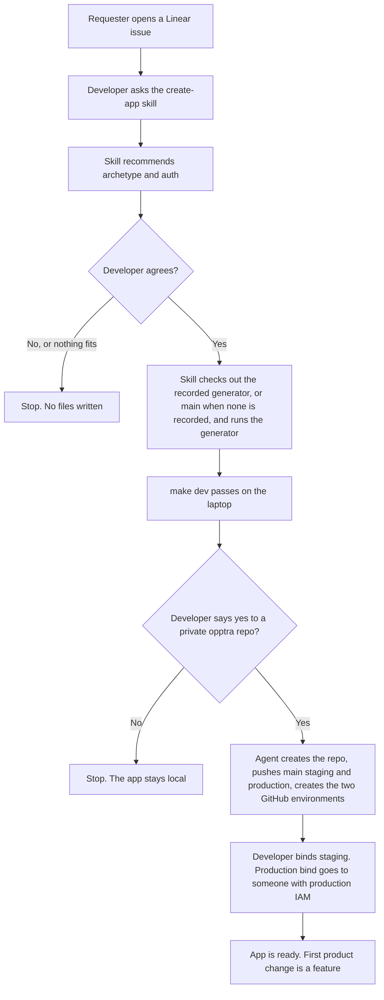
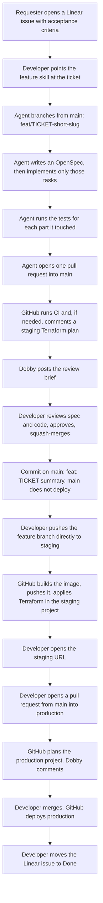
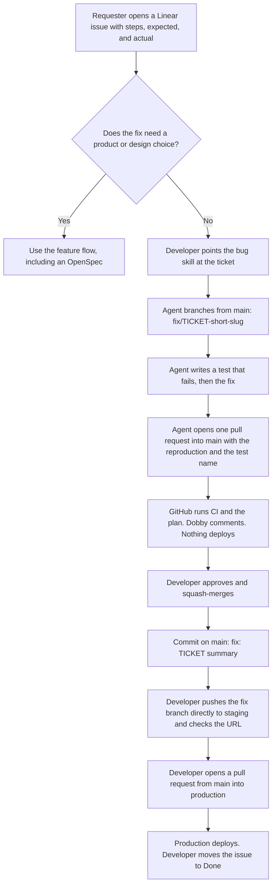

# How an Opptra app is created, changed, and fixed

The skills are already on each developer's machine. They come from `opptra/agent-skills`, installed once via `./install.sh`. Those skills check out the `generator_sha` recorded in `.sdlc/state.yaml` from the local cache (`~/.cache/opptra/sdlc-resources.git`) when they need the generator. They fetch `opptra/sdlc-resources` `main` only when that field is missing, or when the developer asks to upgrade the generator. A phase records the commit it ran. Nobody keeps a manual checkout of `opptra/sdlc-resources` inside an app repo.

If the sentence does not name a skill, use `opptra`. It only picks the route:

| Ask | Skill |
|---|---|
| Mockup, wireframe, prototype, or product screen | `opptra-design-system` |
| Presentation, document, email, or chart | `opptra-branding` |
| Internal dashboard or one-page tool (not a new GitHub app) | `opptra-dashboard` |
| New repository | `create-app` |
| Existing repository onto this standard | `align-app` |
| `deploy.sh`, Cloud Build, Vercel, or manual GCP onto Terraform | `adopt-terraform` |
| Database, bucket, queue, secret, plain environment variable, job, cron, region, or workload | `change-app` |
| New product behavior | `feature` |
| Broken or incorrect behavior | `bug` |
| Am I set up | `doctor` |
| Feedback or a problem with the SDLC itself | `give-feedback`. Files an issue in `opptra/sdlc-resources`. |

A capability change and a product change are two pull requests. `change-app` goes first, in the same chat. The agent opens the `infra/<ticket>-<slug>` pull request and can immediately cut `feat/<ticket>-<slug>` stacked on top of that infra branch (`next_step: code-stacked-on-infra`) so product code and local tests continue without waiting for the infra merge (or pause at `wait-for-infra` if the developer prefers). A feature is `express` when it is one file (test and pull request, no OpenSpec), `standard` when it needs an OpenSpec, or `migration` when a local plan already decided the shape. After the plan is approved, `feature` and `bug` write `.sdlc/intent.yaml` so a new chat continues. That directory is gitignored.

`main` is the default branch and does not deploy. A direct push to `staging` deploys staging. Developers push there without a pull request. `main` is not merged into `staging`. A pull request from `main` into `production` deploys production.

## Prerequisites

| What | When | Who sets it up | Where it comes from |
|---|---|---|---|
| Identity project `opptra-sdlc-ci` and the Workload Identity pool `opptra-github` | Once for the company | Platform owner | [gcp-bootstrap.md](gcp-bootstrap.md). The pool already exists. Do not create a second one. |
| Staging project `opptra-staging`, state buckets, Artifact Registry repo `apps`, billing budgets | Once for the company | Platform owner | [gcp-bootstrap.md](gcp-bootstrap.md). |
| `opptra/sdlc-resources` on GitHub | Once for the company | Platform owner | This repo. A phase records the commit it ran as `generator_sha`. Later runs reuse that commit until someone asks to upgrade. |
| `opptra/agent-skills` linked into Cursor and Claude | Once per person | Each developer | The skills repo. `fetch-skill` updates them. The route banner prints that commit. |
| Linear issue | Every new app, feature, and bug | The person who wants the work | Linear. The issue names users, outcome, production project, and who can sign in. A bug also includes steps, expected result, and actual result. |
| Private GitHub repo in `opptra` | Once per app, after `make dev` passes | The agent, after the developer says yes | `gh repo create opptra/<name> --private`. The agent does not create it before that yes. |
| `main`, `staging`, and `production` branches | Once per app, in the same yes | The agent | `staging` and `production` are created from `main` and pushed. |
| GitHub environments `staging` and `production`, and the four Actions variables | Once per app | The agent creates the two environments. A repository admin sets a required reviewer on `production` when the plan allows it. The Actions variables come from the bind scripts. | [bind.md](bind.md). |
| Staging deployer | Once per app | Developer, when they can change IAM in `opptra-staging` | Run `scripts/bind-staging.sh`, then the two `gh variable set` commands it prints. |
| Production deployer | Once per app | Someone who can change IAM in `prod_project` | The developer sends them `scripts/bind-production.sh`. They run it and set the two production variables. |
| Branch protection | Once per app | Platform owner | An organization ruleset protects `main` and `production`. `staging` is left open so a push can deploy it. |
| Production GCP project | Already exists | Whoever owns that product | Named in the Linear issue and written into `service.yaml` as `prod_project`. |

## New app

The health check or entrypoint test is already green. Nothing has deployed yet.

## New feature

A change to `infra/`, workflows, or `service.yaml` is a `change-app` pull request. It is not mixed into the feature. The agent opens that pull request in the same chat and waits until the developer says it has merged. `express` skips the OpenSpec and still opens one pull request into `main`. After either pull request into `main`, the agent prints the ship card and does not push `staging` unless asked.

A deploy that mounts secrets creates the Secret Manager shells first. If a mounted secret has no version, the action stops and lists the ids. Add a version in Secret Manager and re-run the workflow. The value is not committed. Cloud Run mounts `latest` on that next run.

Those checks are `scripts/check_secret_versions.py` and `scripts/check_firestore.py` in the app repository. The deploy checks out the app, so the files have to be there. `init-runtime` and `sync-infra` copy them from this repository, next to `render_tfvars.py` and `yaml_subset.py`.

An app with `database: firestore` creates one Native `(default)` database in the app region when the project has none. The next app in that project finds it and does not create another. A database that is not Native, or that is in a different region from `service.yaml`, stops the deploy. The deployer needs `roles/datastore.owner` from `scripts/bind-staging.sh` or `scripts/bind-production.sh`. Terraform only grants the runtime account access, so the database is not stored in an app's state.

## Bug

A production bug uses this same path. Staging is a direct push, not a merge from `main`. A rollback is a revert merged to `main`, then a pull request into `production`. The revert branch can also be pushed straight to `staging`. It is not a button that redeploys an older image.
