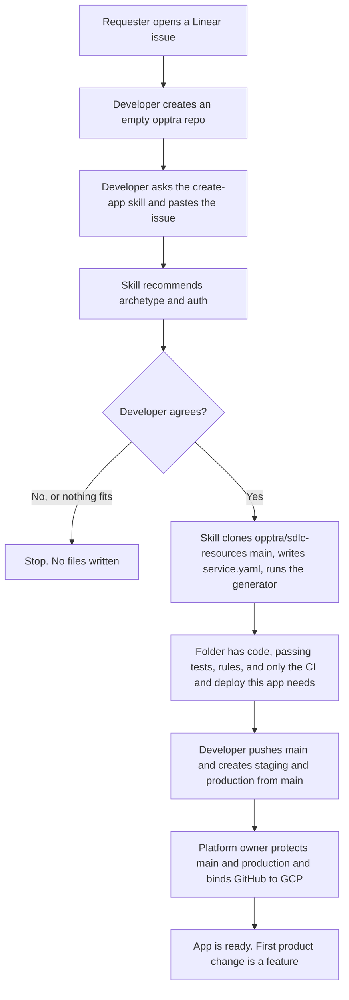
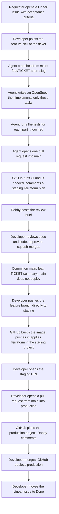
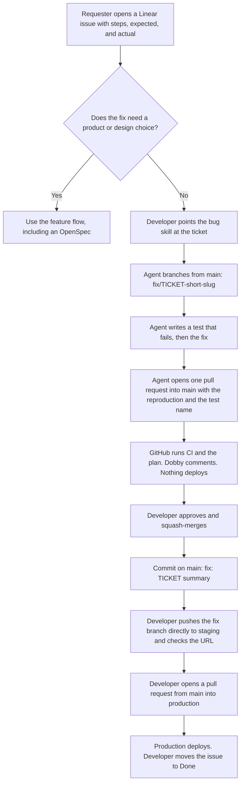

# How an Opptra app is created, changed, and fixed

The skills are already on each developer's machine. They come from `opptra/agent-skills`, installed once. Those skills clone `opptra/sdlc-resources` `main` when they need the generator and record that commit as `generator_sha` in `.sdlc/state.yaml`. Nobody keeps a checkout of `opptra/sdlc-resources`.

If the sentence does not name a skill, use `opptra`. It only picks the route:

| Ask | Skill |
|---|---|
| New repository | `create-app` |
| Existing repository onto this standard | `align-app` |
| `deploy.sh`, Cloud Build, Vercel, or manual GCP onto Terraform | `adopt-terraform` |
| Database, bucket, queue, secret, job, cron, region, or workload | `change-app` |
| New product behavior | `feature` |
| Broken or incorrect behavior | `bug` |

A capability change and a product change are two pull requests. `change-app` goes first. A feature is `express` when it is one file (test and pull request, no OpenSpec), `standard` when it needs an OpenSpec, or `migration` when a local plan already decided the shape. After the plan is approved, `feature` and `bug` write `.sdlc/intent.yaml` so a new chat continues. That directory is gitignored.

`main` is the default branch and does not deploy. A direct push to `staging` deploys staging. Developers push there without a pull request. `main` is not merged into `staging`. A pull request from `main` into `production` deploys production.

## Prerequisites

| What | When | Who sets it up | Where it comes from |
|---|---|---|---|
| Staging GCP project, Workload Identity pool, state buckets, Artifact Registry repo `apps`, billing budgets | Once for the company | Platform owner | `docs/gcp-bootstrap.md` in `opptra/sdlc-resources`. The project id in the draft is `opptra-staging`. |
| `opptra/sdlc-resources` on GitHub `main` | Once for the company | Platform owner | This repo. A phase records the commit it ran as `generator_sha`. |
| `opptra/agent-skills` linked into Cursor and Claude | Once per person | Each developer | The skills repo. `fetch-skill` updates them. The route banner prints that commit. |
| Linear issue | Every new app, feature, and bug | The person who wants the work | Linear. The issue names users, outcome, production project, and who can sign in. A bug also includes steps, expected result, and actual result. |
| Empty GitHub repo in `opptra` | Once per app | The developer | GitHub. The agent does not create it. |
| `main`, `staging`, and `production` branches | Once per app | The developer, after the generator has written the files | `staging` and `production` are created from `main`. |
| Branch protection and the GitHub deploy identity | Once per app | Platform owner | An organization ruleset protects `main` and `production`. `scripts/bind-repo.sh` creates the deployer account and prints four Actions variables. `staging` is left open so a push can deploy it. |
| Production GCP project | Already exists | Whoever owns that product | Named in the Linear issue and written into `service.yaml` as `prod_project`. |

## New app

The health check or entrypoint test is already green. Nothing has deployed yet.

## New feature

A change to `infra/`, workflows, or `service.yaml` is a `change-app` pull request. It is not mixed into the feature. `express` skips the OpenSpec and still opens one pull request into `main`.

## Bug

A production bug uses this same path. Staging is a direct push, not a merge from `main`. A rollback is a revert merged to `main`, then a pull request into `production`. The revert branch can also be pushed straight to `staging`. It is not a button that redeploys an older image.
